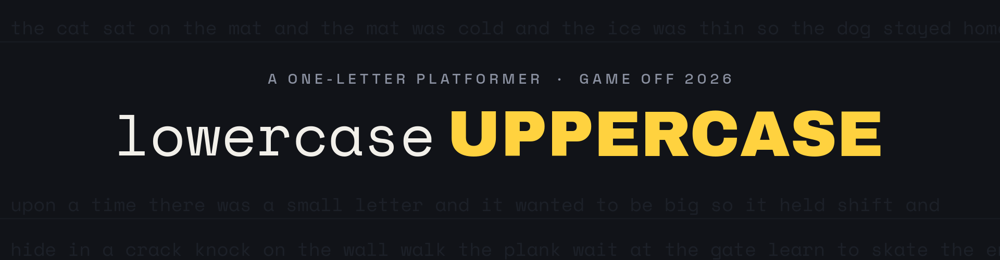
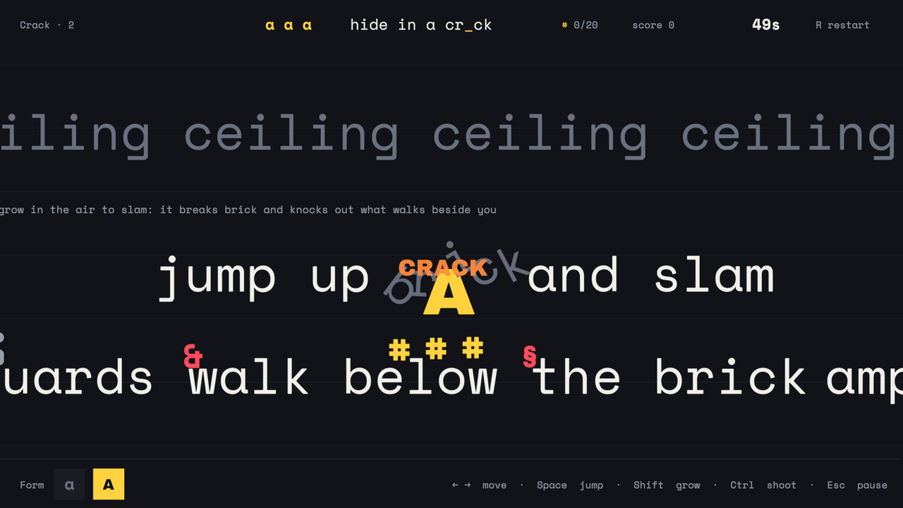
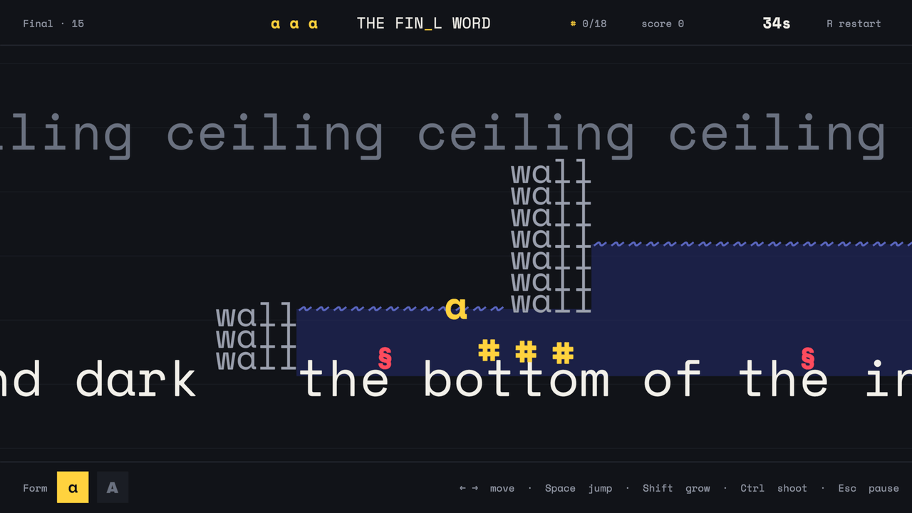
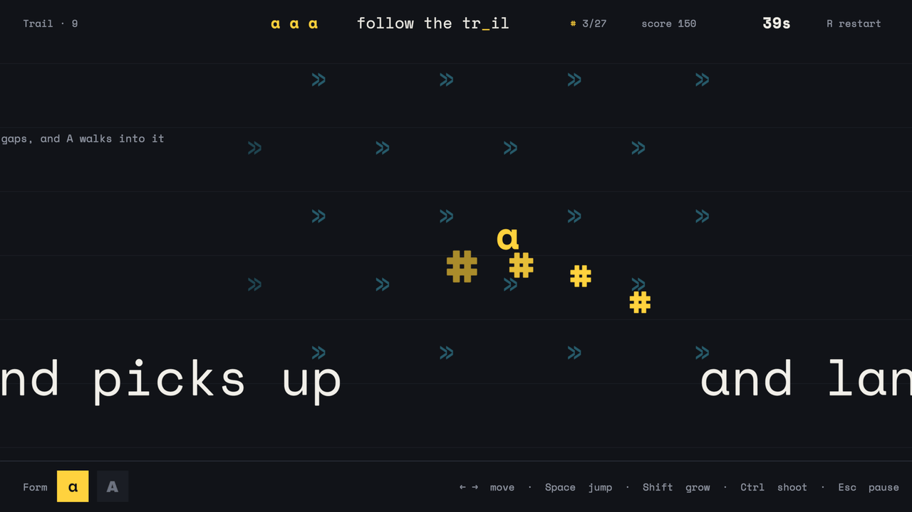
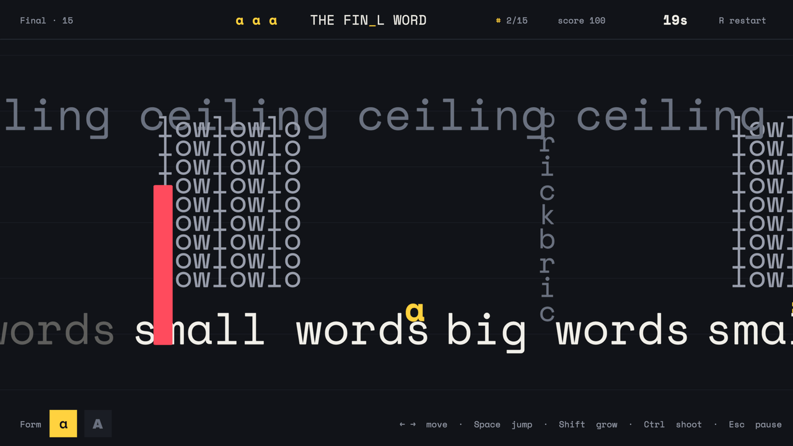
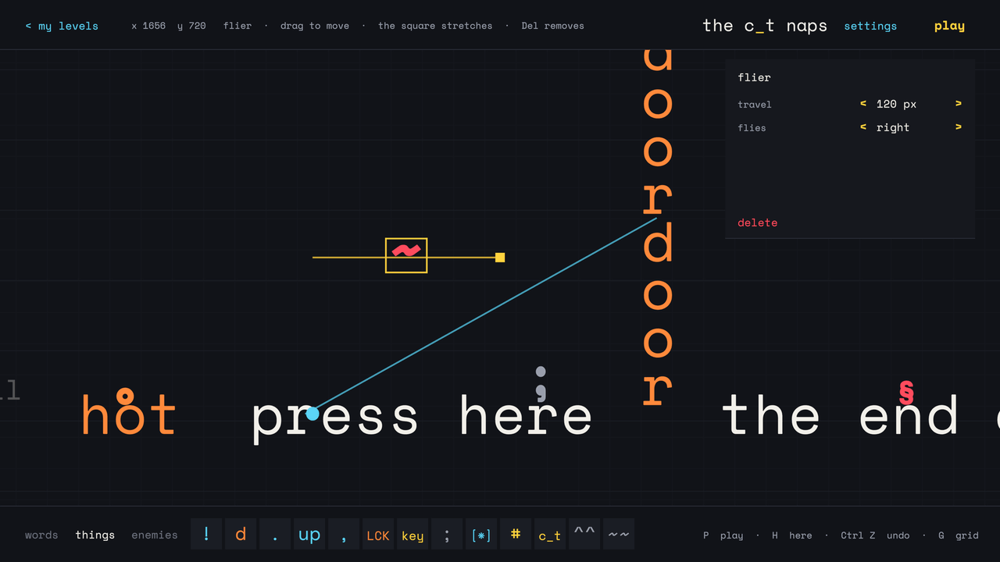

  

  
  
  
  
  
  

<a href="https://devplayrepeat.itch.io/lowercase-uppercase">**lowercase / UPPERCASE**</a> is a platformer about one
missing letter. Every level is a sentence with a blank in it, and the world is built from that sentence: words are
the floors, punctuation is the machinery, and a single yellow letter has to find its way into the gap. *Hide in a
cr_ck.*

Hold <kbd>Shift</kbd> and you are **A**: big, heavy and slow. Let go and you are **a** again: small, light and fast.
One key, two letters, and every obstacle asks the same question: *which form, and when?*

  

## Theme: SHIFT

Made solo for **GitHub Game Off 2026**, whose theme is **SHIFT**, taken literally. On a typewriter, pressing Shift
physically shifted the type into position to print the capital. Here the same key shifts a letter between its two
cases, and with it its size, weight, speed and jump height.

The levels keep shifting the rules of that one key. A gap that wants **a** sits right next to a wall that wants
**A**, so you shift in mid-run. Shifting up in mid-air turns a jump into a slam, and shifting down turns a fall into
a glide. Caps Lock zones shift what Shift itself means.

## Features

- **15 levels in five chapters.** The first two levels of each chapter teach something new, the third tests it. You
  have 60 seconds per level and three lives per run.
- **A world made of text.** A cracked `brick` breaks under A, a `.` holds a door open, `--------` is a bridge only a
  can cross, `,` is a hook to swing from and `!` is a spring. `ice` slides, `hot` burns, `up` is a lift, `float`
  rises under a, `heavy` only moves for A, `~~~` is ink and `»»` is wind.
- **Fifteen enemies**, all of them characters: the walker `&`, the armoured `§`, the eye `ö`, the mimic `b` that
  copies your case, and the cursor `|` that erases the words behind you.
- **World high scores** and the fastest finish of every level, next to your own top 10. One option turns the online
  part off. The [list](https://lowercase-uppercase-levels.devplayrepeat.workers.dev/scores) is on the web too.
- **Endless random levels** stitched together from handmade sections.
- **A level editor** with every piece and enemy, and share codes. Only levels finished in a test play can be shared,
  and a public [gallery](https://lowercase-uppercase-levels.devplayrepeat.workers.dev) collects levels made by
  players.
- **Plays in the browser**, plus Windows and Linux builds, with keyboard or gamepad. Two sets of sound effects, both
  synthesized in code.

<table>
  <tr>
    <td width="50%"></td>
    <td width="50%"></td>
  </tr>
  <tr>
    <td align="center">Ink: a floats, A and enemies sink</td>
    <td align="center">Wind carries a over the widest gaps</td>
  </tr>
  <tr>
    <td width="50%"></td>
    <td width="50%"></td>
  </tr>
  <tr>
    <td align="center">The cursor erases the words behind you</td>
    <td align="center">The level editor</td>
  </tr>
</table>

## Controls

| Keyboard | Gamepad | |
|---|---|---|
| <kbd>←</kbd> <kbd>→</kbd> or <kbd>A</kbd> <kbd>D</kbd> | left stick | move |
| <kbd>Space</kbd>, <kbd>↑</kbd> or <kbd>W</kbd> | A / Cross | jump |
| hold <kbd>Shift</kbd> | hold either trigger | grow into A |
| <kbd>Ctrl</kbd> (<kbd>F</kbd> in the browser) | X / Square | shoot, after hitting a power block |
| <kbd>R</kbd> | | restart the level |
| <kbd>Esc</kbd> | Start | pause |

Grow in mid-air to slam, shrink in mid-air to glide. The level editor needs a mouse and keyboard; **How to play** in
the game has a page on it.

## Building from source

You need **Unity 6000.6.7f1** (Unity 6.6) with WebGL, Linux and Windows (Mono) build support for the targets you
want. The fonts and the TextMesh Pro resources are third-party and not in the repository, so a fresh clone needs
them once:

1. Clone the repository and open the folder in Unity Hub.
2. Choose **Window > TextMeshPro > Import TMP Essential Resources**.
3. Put these files into `Assets/Fonts`: `SpaceMono-Regular.ttf` and `SpaceMono-Bold.ttf`
   ([Space Mono](https://fonts.google.com/specimen/Space+Mono)), `SpaceGrotesk-Regular.ttf`,
   `SpaceGrotesk-Medium.ttf` and `SpaceGrotesk-Bold.ttf`
   ([Space Grotesk](https://fonts.google.com/specimen/Space+Grotesk)) and `ArchivoBlack-Regular.ttf`
   ([Archivo Black](https://fonts.google.com/specimen/Archivo+Black)).
4. Run **lowercase UPPERCASE > Rebuild Prototype Scenes**, **Rebuild Custom Level Scene** and **Rebuild Level Editor
   Scene**. They make the font assets and write the scenes again with them, so leave those scene changes out of your
   commits.
5. Open `Assets/Scenes/Menu.unity` and press Play.
6. Build with **lowercase UPPERCASE > Build > Windows / Linux / Web / All**. The builds land in `Builds/`.

The scenes are generated: change a level in `Assets/Scripts/Levels` and rebuild it from the menu, because edits made
in the scene are overwritten. The tests are in `Assets/Tests` and run in Play mode from **Window > General > Test
Runner**. A clone has no key for the online high scores, so it plays normally but sends nothing
([why](Web/README.md#high-scores)).

## Repository layout

| Path | What is there |
|---|---|
| [`Assets/Scripts`](Assets/Scripts) | The letter, words, enemies, menus, level editor, scores and sound. |
| [`Assets/Scripts/Levels`](Assets/Scripts/Levels) | The builder that writes the 15 levels and the other scenes, and puts random and custom levels together in the game. |
| [`Assets/Editor`](Assets/Editor) | Build menu, run limits for the high scores and test vectors for the web page. |
| [`Assets/Tests`](Assets/Tests) | PlayMode tests. |
| [`Tools/Sfx`](Tools/Sfx) | The Python script that synthesizes the sound effects. |
| [`Itch`](Itch) | Text and pictures of the itch.io page ([README](Itch/README.md)). |
| [`Web`](Web) | The shared level gallery and the high scores on Cloudflare Workers and D1 ([README](Web/README.md)). |

## License

lowercase / UPPERCASE is free software: you can redistribute it and/or modify it under the terms of the
[GNU General Public License](LICENSE), version 3 or (at your option) any later version, with an
additional permission to combine it with the Unity engine and Unity packages. See [COPYING.md](COPYING.md)
for the notice.

The dev.play.repeat. logo is not covered by the GPL: all rights reserved, so replace it if you publish a modified
version.

The fonts [Space Mono](https://github.com/googlefonts/spacemono),
[Space Grotesk](https://github.com/floriankarsten/space-grotesk) and
[Archivo Black](https://github.com/Omnibus-Type/ArchivoBlack) are under the SIL Open Font License 1.1, and the
TextMesh Pro resources are under the Unity Companion License. Neither is part of this repository.

---

Design, code, levels and sound by <b>dev.play.repeat</b> · made with Unity 6

